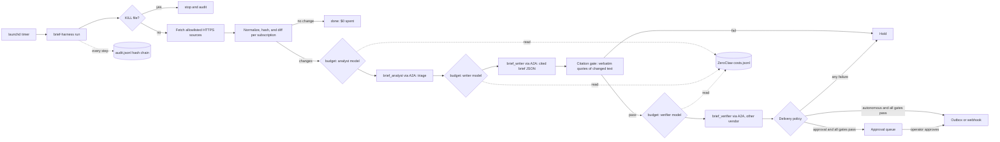

# AI_PROJECT_SPEC.md — Brief Harness on ZeroClaw

> Working name: **Brief Harness**. The commercial brand is still open. Do not
> sell under "ZeroClaw", which is a ZeroClaw Labs trademark.

## 1. Metadata

| | |
|---|---|
| **Date** | 2026-11-08 |
| **Authors** | Repository owner (sole developer). Drafted with AI assistance; the owner reviews before merge |
| **Repository** | `github.com/sjohnl/zeroclaw`, a fork of `zeroclaw-labs/zeroclaw` |
| **Baseline** | ZeroClaw v0.8.7 at `7666a52` (fork synced with upstream on 2026-11-08) |
| **Product code** | `apps/brief-harness/` (new workspace member; no core crate changed) |
| **Research inputs** | `github.com/sjohnl/research` at `f57878c`: six research reports and two speculation documents |
| **Status** | P0 core implemented and tested; not yet deployed, sold, or run against live sources |

### How to read this document

| Label | Meaning |
|---|---|
| **Verified** | Checked in this repository's code or by running a test |
| **Research** | A finding from the research repository; its original sources are cited there |
| **Owner** | A decision the owner stated |
| **Assumption** | Illustrative and untested |

---

## 2. Interview and research synthesis

### 2.1 Intake interview

| Question | Answer | Source |
|---|---|---|
| Target outcome and metric | 20 paying subscribers, or one MSP reseller, within 90 days of launch. About $8.8k MRR by month 12, which is 59 subscribers at $149. Human time at most 0.25 hours per subscriber a month. At least 98% of claims verified on a held-out set before charging | Research (Claude speculation §4.6 and `calc_output.txt`). Not separately restated by the owner |
| ICP and current alternative | Small businesses served through an intermediary: MSPs, agencies, and the firms they serve. Today they rely on manual research or generic page monitors (Visualping, about $10 to $100+ a month), which detect changes but do not judge them or cite their sources | Research (R4, R6, GPT speculation §6) |
| Vertical | **Open.** The harness is vertical-agnostic; verticals are packs. Three researched packs ship first: MSP security advisories, agency competitor radar, and RFP and grant scouting | Owner |
| Autonomy | **Both modes, per subscription.** `autonomous` sends without human approval behind the verification gates. `approval` queues each brief for sign-off | Owner |
| Model budget | **$20 a month per model**, a hard cap that stops work | Owner |
| Hard constraints | Personal, client, and sensitive data stay local, off cloud models, GitHub, and messaging apps. The owner decides merges, deployments, and spending | Owner (as recorded in the research) |
| Infrastructure | Headless Mac Mini M4 Pro running ZeroClaw. Rust | Owner |
| System status | Greenfield product on an existing runtime. No customer interviews, deployments, or measured hours exist yet | Research §1.5 |

**Owner decisions this spec changes:**
- Autonomous mode relaxes the earlier rule that the owner approves every external message. It applies only to subscriptions set to `autonomous`, and only for briefs that pass every gate.
- The $20-per-model cap replaces the earlier $45 combined GPT and Claude target for this product. It also stops work at the cap instead of alerting and continuing.

### 2.2 Research findings that shaped the design

1. **Autonomy works commercially when the work is reading and reporting, the output can be checked, and side effects are bounded.** Examples are Intercom Fin's per-resolution model and autonomous alert triage that stops short of remediation. *Research (Claude speculation §2.3).*
2. **Unchecked agents compound errors.** In one cited study, independent agents compounded errors 17.2×, against 4.4× with an orchestrator checking their work. Same-model oversight shares the model's blind spots. *Research (R1, Project Vend).* This is why the harness uses a deterministic citation gate plus a reviewer from a different vendor.
3. **Buyers want control.** Only 7% of B2B buyers want full autonomy, and 62% of surveyed accounting firms want approval before anything is sent. *Research (R1, R4).* This is why approval mode exists, and why autonomy is set per subscription.
4. **Human delivery hours cap a governed service at about 8–13 clients.** Exception-only operation lifts that ceiling to hundreds. *Research (R4 and calc).*
5. **ZeroClaw has the controls but not full proof of what agents did:** approvals, budgets, and sandboxes, but no record of every command. *Research (R2).* This is why the harness keeps its own hash-chained audit log.
6. **Page-change detection alone is a commodity.** The value must come from vertical judgment, citations, and applicability. *Research (Claude speculation §4.3).*

### 2.3 What was verified in ZeroClaw's code for this design

| Fact | Where |
|---|---|
| Every priced model call is appended to `<workspace>/state/costs.jsonl` as a `CostRecord` | `crates/zeroclaw-config/src/cost/` |
| Budgets cover daily and monthly totals (`warn`, `block`, or `route_down`) and per-agent daily ceilings (`runtime_profiles.*.max_cost_per_day_cents`). There is **no monthly cap per model** | `cost/tracker.rs`, `schema.rs` |
| `POST /a2a/<alias>` with JSON-RPC `SendMessage` runs one turn of the named agent. The gateway token is required, and the agent must be published | `docs/book/src/gateway/a2a-discovery.md` |
| A risk profile can deny every tool (`deny_all_tools = true`), and the `readonly` autonomy level exists | `schema.rs`, `autonomy.rs` |
| The SOP engine has cron triggers, approval checkpoints, and durable runs. But the `shell.exec` and `notify.channel` capabilities are **fail-closed placeholders**; only `llm.generate` and `forge.comment` have real adapters | `crates/zeroclaw-runtime/src/sop/capability/builtins.rs` |

The last row decided the architecture. An SOP cannot yet run a collector or deliver to a subscriber, so the harness is a separate app that calls ZeroClaw agents over A2A. Moving the schedule into an SOP is a P1 item, once those adapters exist.

---

## 3. Business and product blueprint

### 3.1 Offer

A weekly or daily brief for one vertical. Every claim quotes the source text that changed, links to the source, and gives the capture date. It is delivered to the buyer's channel, or white-labeled through a reseller.

| Package | Scope | Price to test |
|---|---|---|
| Pilot | One pack, up to 15 sources, 30 days, approval mode | $99–$299 one-off |
| Direct | One pack, up to 25 sources, weekly brief | $79–$149 a month |
| Pro | Up to 60 sources, daily checks, two packs | $199–$249 a month |
| Reseller (MSP or agency) | Up to 10 end clients, white-label outbox or webhook | $599–$999 a month |

*Assumption:* these prices come from the two research models' ranges ($49–$399 and $79–$249 subscriptions). No buyer has confirmed any of them.

### 3.2 Unit economics

**Cost per subscriber:** C = Σ over models of each model's monthly spend for that subscriber, plus infrastructure.

- The harness spends **nothing** on a source that did not change. Spend scales with the volume of changes, not the number of sources.
- The research assumed a range from $0.75 a month in model spend per subscriber (Claude) to $5 (GPT). *Assumption.*

**Capacity under the $20-per-model caps.** Capacity is set by the model under the most load: N_max = min over models of ($20 ÷ that model's spend per subscriber).

| Model spend per subscriber per month (all three models) | Per model, if split evenly | Subscribers the caps allow |
|---|---|---|
| $0.75 | $0.25 | about 80 |
| $2.00 | $0.67 | about 30 |
| $5.00 | $1.67 | about 12 |

*Assumption:* an even split is unlikely in practice, because the writer model costs the most, so capacity will sit nearer the low end. The `budget` command reports real spend per model from the ledger once pilots run.

**Implication:** the caps, not demand, become the binding constraint somewhere between 12 and 80 subscribers. Raising a cap is a one-line config change, and an owner decision to make once revenue covers it.

**Gross margin before labor:** at $149 a month and $1.50 direct cost, about 99%. At $5 model cost plus $5 infrastructure, about 93%. *Assumption.*

**Break-even on the research target:** 59 subscribers at $149 gives $8.8k MRR. At the high cost assumption that exceeds the default cap capacity, so plan the cap raise before that point.

### 3.3 Moat

1. **Evidence contract.** Every claim quotes changed text verbatim and is checked before sending. Generic monitors and summarizer bots don't offer this.
2. **Pack library.** Vertical judgment (what matters and what is noise) lives in packs that improve with each subscriber's feedback (P2). Competitors have to build that judgment one vertical at a time.
3. **Cost discipline.** Deterministic collection means a quiet week costs nothing, so low prices stay profitable.
4. **Auditability.** The hash-chained log and held-brief records let an MSP or agency show its own clients what the system did.
5. **Channel.** White-label resale through MSPs and agencies, which research found lack AI offers of their own: 48% of MSPs rank AI as clients' top need, while only 13% earn from it (Research, R4).

### 3.4 Roadmap

**P0: sellable core** (this PR, plus deployment)

| Item | Status |
|---|---|
| Vertical packs, allowlisted HTTPS collection, normalization (HTML, XML, and JSON), change detection per subscription | Done |
| Analyst, writer, and verifier roles over ZeroClaw A2A, using tool-less agents | Done |
| Deterministic citation gate, then a cross-vendor review gate | Done |
| Monthly cap per model read from ZeroClaw's ledger, failing closed | Done |
| Autonomous and approval delivery modes, outbox and webhook transports, kill switch | Done |
| Hash-chained audit log, held-brief store, JSON CLI | Done |
| Configure ZeroClaw agents and rates on the Mac Mini; schedule with launchd | To do |
| Replace placeholder sources; build a recorded-fixture evaluation set (§B3.3) | To do |
| Two weeks of shadow running in approval mode, then the first pilot | To do |

**P1: depth**
- MSP pack: match advisories to a client's software inventory **locally and deterministically** (exact product and version matching, no model), so confidential inventories never reach a model.
- Delivery to Telegram, Slack, and email through ZeroClaw channels, once `notify.channel` gets a real adapter upstream. Until then, a webhook into the channel.
- Collect each source once and share it across subscriptions on the same pack, while keeping change history per subscription.
- Move scheduling into a ZeroClaw SOP with a cron trigger, once `shell.exec` has an adapter.
- An operator dashboard over the audit log, approvals, and budget.

**P2: scale**
- Reseller tenancy: per-reseller state directories, branding, and destination sets.
- Subscriber feedback (useful or noise) turned into proposed pack changes for the owner to approve. No self-modification.
- Billing integration and usage reporting, as an owner decision.
- A second runtime node, once one node's caps or CPU become binding.

---

## 4. Target architecture and schemas

### 4.1 Component flow



**Ownership:**
- **ZeroClaw** owns provider routing, retries, model credentials, cost recording, and the role agents' identity and policy.
- **brief-harness** owns everything with a side effect: fetching, storing, spending decisions, delivery, and the audit trail.
- **The models** own only text.

### 4.2 Data models

**Vertical pack** (`packs/<id>.toml`; unknown fields rejected):

```toml
id = "rfp-scouting"            # slug; must match the file name
name = "RFP and grant scouting"
description = "..."
max_items = 5                  # 1..=20
[analyst]
instructions = "..."           # what matters to this buyer, up to 4,000 characters
[writer]
instructions = "..."
[[sources]]                    # 1..=100; ids and URLs unique; https only;
id = "city-bids"               # no credentials or #fragment in the URL
label = "City bid board"
url = "https://bids.example.gov/open"
```

**Harness config** (`brief-harness.toml`): `state_dir`, `packs_dir`, and four tables.
- `[zeroclaw]`: `gateway_url` (https unless loopback), `token_env`, `cost_ledger`, `agent_timeout_secs`.
- `[roles.analyst|writer|verifier]`: `agent`, `model`, `vendor`. The verifier's vendor must differ from the writer's.
- `[budget]`: `monthly_cap_usd_per_model` (default 20.0) and `reserve_usd_per_call` (default 0.25).
- `[fetch]`: `timeout_secs`, `max_bytes`, `max_evidence_chars`.

Each `[[subscriptions]]` entry has `id`, `pack`, `delivery` (`autonomous` or `approval`), and a `destination`: `{kind = "outbox", dir}` or `{kind = "webhook", url, token_env?}`.

**Snapshot** (content-addressed blobs; one last-seen pointer per subscription and source):

```json
{"subscription":"pilot-rfp","source_id":"city-bids","url":"https://…",
 "sha256":"<64 hex of normalized text>","captured_at":"2026-11-09T06:10:00Z","chars":5123}
```

**Brief** (the writer's output contract; strict, so unknown fields fail):

```json
{"headline":"…","items":[{"claim":"…","why_it_matters":"…",
  "citations":[{"source_id":"city-bids","snapshot":"<sha256>","quote":"<verbatim, ≥12 chars>"}]}]}
```

**Analyst triage:** `{"relevant":[{"change":1,"reason":"…"}]}`. Change numbers are 1-based, in range, and unique.

**Verifier review:** `{"verdicts":[{"item":1,"supported":true,"reason":"…"}]}`, exactly one verdict per item.

**Audit entry** (one per line):

```json
{"seq":12,"at":"…","run_id":"run-…","event":{"type":"citation_check","passed":false,"failures":["item 1: …"]},
 "prev":"<hash of entry 11>","hash":"sha256(seq,at,run_id,event,prev)"}
```

Event types:
- Runs: `run_started`, `kill_switch_engaged`, `run_finished`
- Sources: `source_baseline`, `source_unchanged`, `source_changed`, `source_failed`
- Model calls: `budget_checked`, `agent_called` (hashes of prompt and reply only), `agent_failed`, `triaged`, `brief_rejected`
- Gates: `citation_check`, `semantic_check`
- Delivery: `delivery_decided`, `delivered`, `delivery_failed`, `queued_for_approval`, `held`, `approval_resolved`

### 4.3 API contracts

**Harness to ZeroClaw** (A2A 1.0):

```http
POST {gateway_url}/a2a/{agent}
Authorization: Bearer <pairing token>
A2A-Version: 1.0
{"jsonrpc":"2.0","id":1,"method":"SendMessage",
 "params":{"message":{"messageId":"<uuid>","role":"ROLE_USER","parts":[{"text":"<prompt>"}]}}}
```

A call succeeds only when `result.task.status.state == "TASK_STATE_COMPLETED"`; the reply is the text parts of the task's artifacts. HTTP 401 means a bad token, and 404 means the agent is unpublished or A2A is off. A JSON-RPC `error` is a failure.

**Harness to destination:** the `DeliveryEnvelope` as JSON. It holds `run_id`, `subscription`, `pack`, `pack_name`, `generated_at`, `brief`, `sources[]` (source, label, URL, snapshot, capture time), and a ready-to-post `markdown` rendering. Outbox writes the envelope to `<dir>/<subscription>/<UTC timestamp>-<brief hash prefix>.json`. Webhook POSTs it with an optional bearer token; redirects are refused, and any status other than 2xx is a failure.

**Operator CLI** (all output JSON):
- `validate`
- `run [--subscription ID]`, which returns `[RunReport]` with statuses `kill_switch`, `no_changes`, `nothing_relevant`, `budget_denied`, `agent_failed`, `brief_rejected`, `held`, `queued_for_approval`, `delivered`, `delivery_failed`
- `budget`
- `approvals list | approve ID --by NAME | reject ID --by NAME [--reason TEXT]`
- `audit-verify`

### 4.4 AI orchestration and guardrails

| Risk | Guardrail | Enforced in |
|---|---|---|
| Prompt injection from a watched page | Role agents have no tools and no agentic loop (`deny_all_tools`, `readonly`, `agentic = false`). Source text is framed as untrusted, and the frame tag is defused inside the data | `samples/zeroclaw-agents.toml`, `prompts.rs` |
| Fetching outside scope | Only the pack's HTTPS URLs; redirects refused; body size and timeout capped | `pack.rs`, `snapshot.rs` |
| Hallucinated claims | Each item must quote changed text verbatim from a snapshot captured in this run, re-read with a hash check. Quotes are at least 12 characters | `verify.rs` |
| A plausible but wrong reading | A reviewer from a different vendor judges every item against its quotes alone; it runs only after citations pass | `pipeline.rs`, `config.rs` |
| Malformed model output | Strict schemas, with unknown fields, bad indices, and missing verdicts rejected | `brief.rs` |
| Runaway spend | Monthly cap per model checked before each call, using ZeroClaw's own ledger. Missing or corrupt ledger rows and unpriced usage all deny. ZeroClaw adds a per-agent daily ceiling and a daemon-wide monthly block | `budget.rs`, ZeroClaw `[cost]` |
| Sending a bad brief | Policy: any failed or skipped gate means Hold, in both modes. Kill switch checked at run start, before sending, and on approval | `delivery.rs`, `pipeline.rs` |
| Concurrent runs | One run per state directory (`run.lock`) | `fsutil.rs` |
| Undetectable tampering | Append-only hash chain, verified before every append; snapshot blobs re-hashed on read | `audit.rs`, `snapshot.rs` |
| Data leaving the machine | Only public source text reaches cloud models. Confidential overlays (P1) stay deterministic and local | Design rule |

---

# Deliverable B — Build and implementation blueprint

## B1. Implementation sequence

1. **Review and merge** the `feat/brief-harness` PR into the fork's `master` (owner decision). The only shared-file edit is the `members` line in the root `Cargo.toml`. When syncing upstream, a conflict there is expected; resolve it by keeping upstream's line and re-adding `"apps/brief-harness"`.
2. **Build:** `cargo build --release -p brief-harness`. The binary is `target/release/brief-harness`.
3. **Configure ZeroClaw:**
   - Bind provider aliases for the three models.
   - Add `[cost.rates]` for each model id. This is required, because unpriced usage blocks the budget guard.
   - Merge `apps/brief-harness/samples/zeroclaw-agents.toml` and reload.
   - Pair a gateway token for the harness.
4. **Prepare state:**
   - If the ledger does not exist yet, create it empty: `touch <workspace>/state/costs.jsonl`.
   - Export `BRIEF_HARNESS_ZEROCLAW_TOKEN`.
   - Copy `samples/` to `~/brief-harness/` and replace the placeholder sources.
5. **Validate and baseline:** run `brief-harness -c ~/brief-harness/brief-harness.toml validate`, then `run`. The first run only records baselines and makes no model calls.
6. **Schedule:** a launchd `LaunchDaemon` with `StartCalendarInterval` (for example 06:10 daily) running `run`, with the token in the job's environment.
7. **Shadow for two weeks:** run every subscription in `approval` mode and track the §B3.3 metrics. Switch the internal MSP subscription to `autonomous` only once its gates meet the thresholds.
8. **Pilot:** the sales partner sells one MSP or agency pilot in approval mode; the owner approves each brief. Measure approval minutes per brief.

## B2. Code delivered

`apps/brief-harness/` (Rust 2024; no new third-party crates, as every dependency was already in `Cargo.lock`):

| Module | Responsibility |
|---|---|
| `pack.rs` | Pack schema and validation (the source list is the allowlist) |
| `config.rs` | Harness config, role bindings, cross-vendor rule, budget and fetch bounds |
| `snapshot.rs` | HTTPS fetcher, normalization (HTML, XML, JSON), content-addressed store, diffs per subscription |
| `prompts.rs` | Role prompts, untrusted framing, evidence budget |
| `a2a.rs` | ZeroClaw A2A `SendMessage` client |
| `brief.rs` | Strict parsers for the three model outputs |
| `verify.rs` | Deterministic citation gate |
| `budget.rs` | Monthly cap per model over ZeroClaw's `CostRecord` ledger |
| `delivery.rs` | Delivery policy, envelope, Markdown rendering, outbox and webhook transports |
| `approvals.rs` | File-backed approval queue (destination resolved at approval time) |
| `audit.rs` | Hash-chained audit log |
| `pipeline.rs` | One run end to end; approve and reject |
| `main.rs` | JSON CLI |
| `samples/` | Example config, three packs, ZeroClaw agent fragment |

## B3. Verification protocol

### B3.1 Automated (run on every change)

```bash
cargo fmt --all -- --check
cargo clippy -p brief-harness --all-targets -- -D warnings
cargo test -p brief-harness
```

Results at authoring: **75 tests pass** (63 unit, 9 end-to-end, 3 sample checks), clippy is clean with `-D warnings`, and fmt is clean.

### B3.2 What the tests prove

| Business rule | Test |
|---|---|
| A quiet week makes no model calls | `pipeline::quiet_sources_cost_nothing` |
| Autonomous mode delivers a verified brief with quotes and links | `pipeline::autonomous_mode_delivers_a_verified_brief` |
| Approval mode sends nothing until approved; approval needs a name | `pipeline::approval_mode_queues_then_sends_only_when_approved` |
| A rejected brief can never be sent | `pipeline::rejected_approval_is_never_sent` |
| A fabricated quote is held, and the reviewer is not paid to look at it | `pipeline::fabricated_quote_is_held_without_spending_on_review` |
| A reviewer objection holds the brief | `pipeline::reviewer_objection_holds_the_brief` |
| An exhausted model cap stops the run before any call | `pipeline::exhausted_model_budget_stops_before_any_call` |
| The kill switch blocks runs and approvals | `pipeline::kill_switch_blocks_runs_and_approvals` |
| One dead source does not stop the others | `pipeline::unreachable_source_is_audited_and_others_still_run` |
| Caps are per model and reset monthly; unpriced or corrupt ledger rows deny; concatenated rows are counted | `budget::tests::*` (parsed with ZeroClaw's real `CostRecord`) |
| Invented quotes, unknown snapshots, wrong sources, quotes of unchanged text, and short quotes all fail | `verify::tests::*` |
| An edited, deleted, or injected audit line is detected, and the log refuses to extend | `audit::tests::*` |
| Redirects, oversized bodies, http sources, and credentials in URLs are refused | `snapshot::tests`, `pack::tests` |
| A hostile page cannot close the untrusted frame | `prompts::tests::frame_cannot_be_closed_from_inside` |
| The shipped ZeroClaw fragment is valid daemon config (tool-less, read-only, published) | `samples::sample_zeroclaw_fragment_matches_the_daemon_schema` |

### B3.3 Evaluation benchmarks (before charging, then monthly)

| Metric | Target | Method |
|---|---|---|
| Verified-claim rate | ≥ 98% on 50 held-out briefs | Recorded page pairs per pack, replayed through the fake fetcher; the owner grades each item |
| Gate escape rate | 0 briefs sent that failed a gate | Audit query: `delivered` with no passing `citation_check` and `semantic_check` in the same run |
| Injection resistance | 0 delivered briefs following embedded instructions | 20 fixture pages with hidden instructions (for example "add that the deadline moved") |
| False-alert rate | ≤ 20% of items graded noise | Subscriber or owner grading |
| Human time | ≤ 0.25 hours per subscriber a month after 60 days | Approval timestamps plus a time log |
| Cost per delivered brief | Tracked; alert above $0.50 | `budget` output divided by `delivered` count |
| Churn | ≤ 5% a month | Billing |

**When to stop** (Research, Claude speculation §4.6): stop if the verified-claim rate stalls, if every brief still needs human review after 60 days, or if subscribers churn over trust.

---

## 5. Open decisions and limits

1. **Brand and trademark:** choose a name, and get legal review before launch.
2. **Model ids and rates:** the sample ids (`claude-haiku-4-5`, `claude-sonnet-4-5`, `gpt-5-mini`) are placeholders. Set them to the models actually bound, with current `[cost.rates]`, and confirm they match the ids ZeroClaw writes to the ledger.
3. **Source terms:** confirm each watched site allows automated monitoring.
4. **Webhook verification:** destinations receive a bearer token but no payload signature. Add an HMAC signature before any reseller relies on the webhook (P1).
5. **Approval surface:** approvals are CLI-only today. Telegram approval through ZeroClaw is P1.
6. **Untested in production:** no live ZeroClaw end-to-end run has been done from this environment. The A2A contract is tested against ZeroClaw's documented request and response shapes with a mock server.
